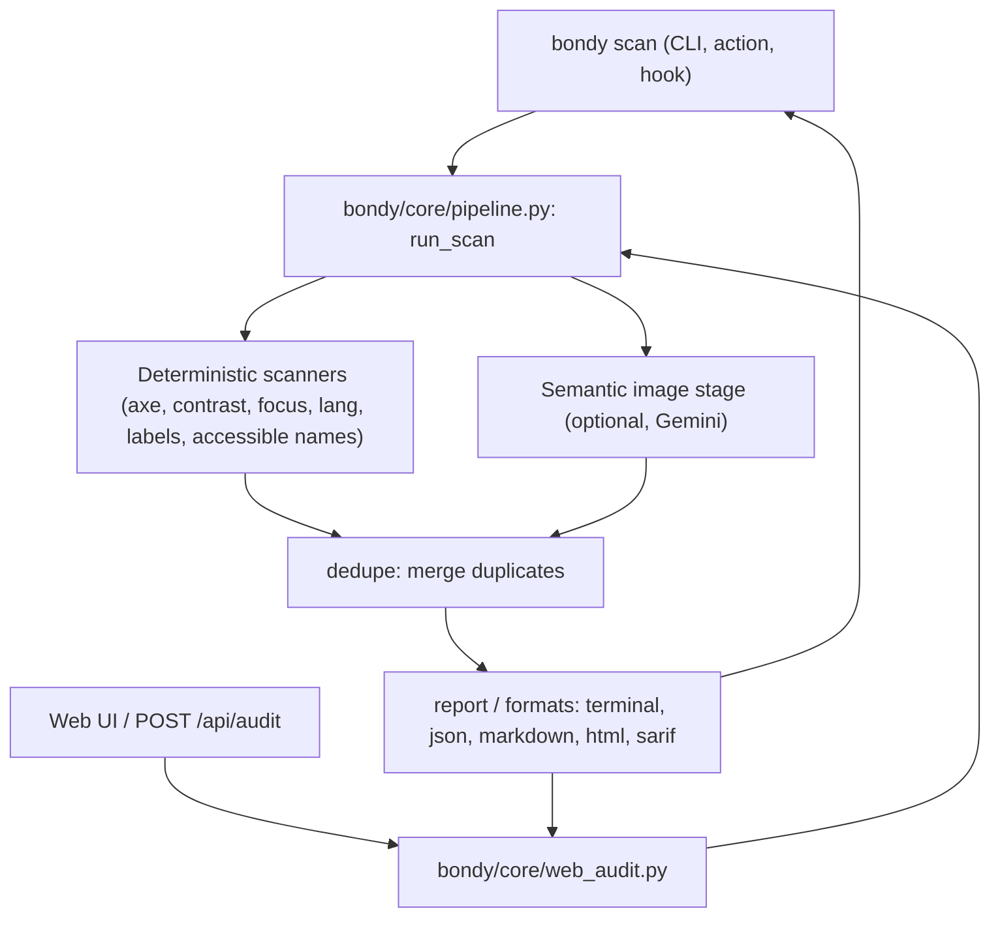

<div align="center">
  
  <h1>Bondy</h1>
  <p><strong>A local, bring-your-own-key web accessibility auditor (WCAG 2.2 AA): deterministic scanners plus an optional Gemini vision stage.</strong></p>
</div>

Bondy scans HTML files with deterministic Playwright/axe-core routines and, when you provide your own Gemini API key, adds a semantic stage that judges image alt text and suggests exact code fixes. It runs as a command line tool (`bondy`), as a GitHub Action / pre-commit hook and as a small local web UI.

---

## Table of Contents
- [The Problem](#the-problem)
- [The Solution](#the-solution)
- [Features](#features)
- [How it works](#how-it-works)
- [Quick Start](#quick-start)
  - [Install](#install)
  - [Quick start: command line](#quick-start-command-line)
  - [Quick start: web UI](#quick-start-web-ui)
- [API key and configuration](#api-key-and-configuration)
- [CLI reference](#cli-reference)
- [Reports, baselines, suppressions](#reports-baselines-suppressions)
- [CI, pre-commit and Docker](#ci-pre-commit-and-docker)
- [Known limitations](#known-limitations)
- [Deployment to Google Cloud (optional, legacy)](#deployment-to-google-cloud-optional-legacy)
- [Testing & Linting](#testing--linting)
- [Security](#security)
- [Contributors](#contributors)
- [References](#references)

---

## The Problem

According to the WebAIM Million report, **95.9% of home pages presented detectable WCAG 2 failures**, reversing the trend of small improvements observed over the previous six years (WebAIM, 2026). This reversal and stagnation in web accessibility may be heavily exacerbated by the rapid proliferation of AI-assisted coding tools. While developers increasingly rely on Large Language Models (LLMs) to generate web applications, these models often produce boilerplate HTML that lacks proper semantic structure and fails to adhere to modern accessibility standards.

Manual web accessibility audits are resource-intensive, slow, and expensive. Static code analyzers (like Lighthouse) only check for the presence of HTML attributes but cannot evaluate their semantic quality or catch dynamic interaction bugs. 

Strikingly, **96% of all detected errors fall into just six categories**:
1. Low contrast text (83.9%)
2. Missing alternative text for images (53.1%)
3. Missing form input labels (51%)
4. Empty links (46.3%)
5. Empty buttons (30.6%)
6. Missing document language (13.5%)

Fixing just these issues would significantly improve web accessibility globally.

## The Solution

**Bondy** bridges the gap between passive static linters and expensive human auditors. Tools like Google Lighthouse check whether an `alt` attribute exists; they do not judge whether the image is decorative or whether the text makes sense.

Bondy combines **deterministic browser automation (Playwright + axe-core)** with the **reasoning of a multimodal LLM (Gemini)** for the part code cannot decide:

1. **Navigates like a human**: it tabs through the DOM with Playwright to detect invisible focus traps and illogical tab sequences.
2. **Sees like a human**: for `` elements, code triages first (decorative signals, redundant "image of" prefixes, images that cannot be loaded) and only the rest goes to Gemini, which judges whether the alt text matches the image and whether it is decorative, informative or functional.
3. **Suggests the fix**: for image alt text it produces the exact before/after HTML snippet; for the other findings it explains what to change.

## Features

- **Code-driven pipeline**: scanners, then a semantic image stage, then fixes and a report. Code decides the order of steps and the final keep/fix/manual-review decision; the model only judges what an image shows (see [docs/architecture.md](docs/architecture.md)).
- **Deterministic baseline**: axe-core (WCAG 2.0/2.1/2.2 A/AA) plus Chromium's accessibility tree, computed contrast, keyboard focus (trap/order), `lang`, form labels and accessible names. Works offline with no API key (`--no-llm`).
- **Static mode**: without a usable browser (or with `--static`) Bondy still runs the HTML-parsing checks and says which ones it skipped.
- **Bring your own key, with limits**: hard caps (`--max-requests`, `--max-usd`, `--max-pages`, `--max-images`), estimates before spending (`bondy estimate`, `--dry-run`) and a notice of what is sent to the provider before it is sent.
- **Cache, incremental scans and resume**: `--changed-only`, `--since <git-ref>`, `--resume`.
- **Several report formats**: terminal, JSON, Markdown, HTML and SARIF 2.1.0 (GitHub code scanning).
- **Baselines and suppressions with a reason**, so only new findings fail CI.
- **Duplicate merging**: the same problem reported by several scanners on the same element is shown once.
- **Safe auto-fix in the web UI**: "Apply to File" is offered only for image patches whose original snippet appears exactly once in the file.
- **Security guardrails**: SSRF guard for remote images, network-blocked page rendering, secret redaction before anything is sent to the model, localhost-only file writes. See [Security](#security).

## How it works



Details, the module map and what is legacy (the ADK agent `bondy/agent.py` and the MCP server) are in [docs/architecture.md](docs/architecture.md). The history of decisions and pending work is in [docs/improvement-plan.md](docs/improvement-plan.md) and [CHANGELOG.md](CHANGELOG.md).

## Quick Start

### Install

Prerequisites:
- Python 3.11 to 3.13 (`requires-python = ">=3.11,<3.14"`).
- [`uv`](https://docs.astral.sh/uv/) (Python package manager).
- Chromium for the browser-based checks (optional: without it Bondy runs in static mode).
- A Gemini API key from [Google AI Studio](https://aistudio.google.com/apikey) **only if** you want the semantic image stage. Everything else works without a key.

```bash
uv sync                                  # dev checkout: core + dev group (includes server + agent)
uv run playwright install chromium       # add --with-deps on Linux
```

Other install shapes:

```bash
uv sync --no-dev --extra server --extra agent   # run the web UI only
uv pip install "bondy[server,agent]"            # from a built wheel / index
```

| Extra | Adds | Needed for |
| :--- | :--- | :--- |
| _(none)_ | `playwright`, `google-genai`, `pydantic` | CLI: deterministic scanners and the Gemini image stage |
| `server` | `fastapi`, `uvicorn`, `python-dotenv` | Local web UI / HTTP API (`bondy.fast_api_app`) |
| `agent` | `google-adk` | `bondy.fast_api_app` still imports ADK, so install `server` + `agent` together |
| `gcp` | `google-adk[gcp]`, Cloud Logging, GCS, OpenTelemetry GenAI | Cloud Run / Vertex AI deployments only |
| `mcp` | `mcp`, `PyGithub` | `mcp_server/github_server.py` |
| `eval`, `lint` | evaluation / ruff, ty, codespell | Evaluations and linting |

**Telemetry is off by default.** Nothing is sent to Google Cloud unless you install the `gcp` extra *and* opt in with `BONDY_CLOUD_LOGGING=1` (Cloud Logging) and/or `LOGS_BUCKET_NAME` + `OTEL_INSTRUMENTATION_GENAI_CAPTURE_MESSAGE_CONTENT` (GenAI telemetry).

### Quick start: command line

```bash
bondy --version
bondy doctor                              # offline check: Python, Chromium, axe-core, config, API key
bondy scan ./my-site --no-llm             # deterministic scanners on a file or folder; no key, no network
bondy scan ./my-site                      # + semantic image stage when an API key is available
bondy scan index.html about.html docs/    # several files/folders; duplicates are scanned once
bondy scan page.html --format json --fail-on warning
bondy estimate ./my-site                  # requests / tokens estimate; calls no model
```

Try it on the bundled sample pages: `bondy scan examples --no-llm`. If `bondy` is not on your `PATH`, use `uv run bondy ...` or `python -m bondy ...` (inside the virtualenv).

Exit codes: `0` nothing at/above `--fail-on` (default `critical`); `1` findings at/above it; `2` usage/config error or a scanner failed (incomplete result); `3` **partial** result (a hard limit, the API quota, `--scan-timeout` or Ctrl+C stopped the scan and nothing at/above the threshold was found).

### Quick start: web UI

```bash
uv run python -m uvicorn bondy.fast_api_app:app --port 8080
# without uv, inside the virtualenv (Windows: .venv\Scripts\python.exe):
python -m uvicorn bondy.fast_api_app:app --port 8080
```

Open <http://localhost:8080>. Notes:

- **Local only.** uvicorn binds to `127.0.0.1` by default; do not expose it with `--host 0.0.0.0`, because `POST /api/apply-fix` writes to disk. That endpoint accepts requests from localhost only, or a valid `X-API-Key` header when `BONDY_API_KEY` is set.
- **Spend no quota:** start it with `BONDY_NO_LLM=1` (PowerShell: `$env:BONDY_NO_LLM="1"`; Bash: `export BONDY_NO_LLM=1`) to run only the deterministic checks. Without an API key it does the same and says so in `notes`. Check that port 8080 is free: an older server on the same port would silently answer instead.
- **What it accepts.** Either HTML pasted in the UI's HTML tab, or a path inside the repository's `examples/` folder, relative to the repository root: `examples/site_1_bad_alt` or `examples/my_folder/index.html`. A folder resolves to its `index.html`. Absolute paths, `..` and anything outside `examples/` are rejected with HTTP 403 (the old `demo_sites/` paths too). To audit your own pages, drop them into `examples/` or use the CLI, which accepts any local path.
- **"Apply to File"** is offered only for image patches (alt text) whose original snippet appears exactly once in the file; other findings carry advice text only.
- The UI runs the same pipeline as the CLI (`bondy/core/web_audit.py`), with a verdict cache in `.bondy/cache` at the repository root (git-ignored).

## API key and configuration

The CLI and the web server read the Gemini API key from `GEMINI_API_KEY` (first) or `GOOGLE_API_KEY`, set in the environment or in a `.env` file at the project root. Copy `.env.example` to `.env` and fill one of them in (make sure `.env` is in your `.gitignore`):

```env
GEMINI_API_KEY=your-ai-studio-api-key
```

- The CLI reads **only those two variables** from `.env`, looking from the current folder up to the project root (`.git` or `bondy.toml`), and never exports anything. Precedence: flag (programmatic use only: the CLI has no `--api-key` option) > shell variable > `.env`. The web server loads the repository-root `.env` into its environment with `python-dotenv`, without overriding variables already set.
- The key is intentionally **not** accepted in `bondy.toml`, because that file is meant to be committed. It is never printed: `bondy doctor` only says where it was found, and `bondy doctor --check-key` validates it with one minimal request (opt-in; plain `doctor` stays offline).
- The semantic stage always talks to the Gemini API with an AI Studio key. `GOOGLE_GENAI_USE_VERTEXAI` / `GOOGLE_CLOUD_PROJECT` / `GOOGLE_CLOUD_LOCATION` only affect the legacy ADK agent (see [docs/architecture.md](docs/architecture.md)).
- The free tier of the Gemini API has low quotas and may use content to improve Google products.

### Models and quota

| Setting | Env variable | Default | Purpose |
| :--- | :--- | :--- | :--- |
| `model` | `BONDY_MODEL` | `gemini-flash-latest` | Primary model for text requests. |
| `vision_model` | `BONDY_VISION_MODEL` | `gemini-flash-latest` | Primary model for requests that carry images (the semantic image stage). |
| `fallback_model` | `BONDY_FALLBACK_MODEL` | `gemini-3.5-flash-lite` | Used when the primary model fails (empty disables it). |

Each request tries the primary model first. A per-minute 429 is retried once after the server's `retryDelay`; a daily quota, a 503, a timeout or any other error moves to the fallback model immediately. **Practical consequence:** if the primary model answers 429 for your key, every batch spends one extra request (two with a per-minute 429) before it reaches the fallback, and those requests count against `--max-requests`. Set `BONDY_MODEL` and `BONDY_VISION_MODEL` to the model that actually works for you (for example `gemini-3.5-flash-lite`) to avoid it.

### Configuration precedence

**Flag > environment variable > `bondy.toml` > default.** `bondy.toml` is searched upward from the current directory (or pass `--config`). Keys: `model`, `vision_model`, `fallback_model`, `no_llm`, `static`, `format` (`terminal`|`json`|`markdown`|`html`|`sarif`), `fail_on` (`critical`|`warning`|`never`), `checks`, `include`, `exclude`, `batch_size`, `max_requests`, `max_usd`, `max_pages`, `max_images`, `price_input_per_mtok`, `price_output_per_mtok`, `tokens_per_image`, `remote_images`, `cache`, `cache_dir`, `timeout`, `scan_timeout`, `baseline`, and `[[ignore]]` tables (file only). Each key has an environment variable (`BONDY_MODEL`, `BONDY_VISION_MODEL`, `BONDY_FALLBACK_MODEL`, `BONDY_NO_LLM`, `BONDY_STATIC`, `BONDY_FORMAT`, `BONDY_FAIL_ON`, `BONDY_CHECKS`, `BONDY_INCLUDE`, `BONDY_EXCLUDE`, `BONDY_BATCH_SIZE`, `BONDY_MAX_REQUESTS`, `BONDY_MAX_USD`, `BONDY_MAX_PAGES`, `BONDY_MAX_IMAGES`, `BONDY_PRICE_INPUT_PER_MTOK`, `BONDY_PRICE_OUTPUT_PER_MTOK`, `BONDY_TOKENS_PER_IMAGE`, `BONDY_REMOTE_IMAGES`, `BONDY_CACHE`, `BONDY_CACHE_DIR`, `BONDY_TIMEOUT`, `BONDY_SCAN_TIMEOUT`, `BONDY_BASELINE`; lists are comma-separated).

```toml
# bondy.toml
fail_on = "warning"
checks = ["WCAG 1.1.1", "WCAG 3.1.1"]
exclude = ["node_modules/**", "dist/**"]
```

Other environment variables:

| Variable | Purpose |
| :--- | :--- |
| `BONDY_API_KEY` | If set, `POST /api/apply-fix` requires an `X-API-Key` header. If unset, only localhost can write files. Unrelated to the Gemini key. |
| `BONDY_CLOUD_LOGGING` | `1` enables Cloud Logging (needs the `gcp` extra). |

## CLI reference

Run `bondy <command> --help` for the authoritative list of flags. Commands: `scan`, `estimate`, `doctor`, `baseline create`, `cache clear`.

### Scanning

`bondy scan PATH [PATH ...]` accepts several files and folders (what the pre-commit hook uses): every missing path is reported at once with exit code 2, and report paths are relative to the common folder of all of them (scan a folder if you need stable paths for baselines or SARIF).

It runs axe-core, contrast, keyboard focus (trap/order), `lang`, form labels and accessible-name checks. Without `--no-llm` and **with an API key** it also runs a semantic stage on `` elements: **several images per request** (`--batch-size`, default 8), with one fused call that judges the alt text and the decorative/informative/functional class. The final keep/fix/manual-review decision is made in code. Without a key it falls back to `--no-llm` and says so. `--static` forces static mode (HTML parsing only, never launches a browser).

**Progress and notice.** Progress (page, image and request batch) and the notice of what is sent to the model go to **stderr**, so `--format json` on stdout stays clean. Progress is shown by default only on a terminal: `--progress` forces it, `-q/--quiet` hides it. In LLM mode, before the first download or request, Bondy prints a `NOTICE` with the provider host, the model, how many images (with their alt text and a short HTML snippet) it may send and whether http(s) images will be downloaded; `--quiet` does not hide it.

`--mode agent` (the ADK agent) is not available in the CLI yet (pending in `docs/improvement-plan.md`, P4).

### Limits, cost and prices

```bash
bondy estimate ./my-site                  # requests / tokens / cost estimate; calls no model
bondy scan ./my-site --dry-run            # same estimate, runs nothing
bondy scan ./my-site --max-requests 20 --max-usd 0.50 --max-pages 50 --max-images 100
```

Hard limits (`--max-requests`, `--max-usd`, `--max-pages`, `--max-images`; also `bondy.toml`/`BONDY_MAX_*`) stop the scan and print a PARTIAL RESULT with the reason. `--max-requests` counts HTTP requests to the model, retries included, and has a **default of 50**; `0` means no limit (the summary says when the cap in force is the default and how to change it). The other limits are unlimited unless set. At the end of every LLM scan Bondy prints what it used: requests, batches, images verified/skipped, tokens (when the provider reports them) and an **estimated** cost.

**Prices are never assumed.** Bondy ships no price values: set `price_input_per_mtok` and `price_output_per_mtok` (USD per million tokens, from your provider's price list) in `bondy.toml` or `BONDY_PRICE_INPUT_PER_MTOK` / `BONDY_PRICE_OUTPUT_PER_MTOK`. Without them `estimate`, `--dry-run` and the usage summary show requests and tokens and say the dollar cost is not available (JSON: `cost_usd: null` plus `cost_unavailable_reason`). `--max-usd` needs prices: without them the command fails with exit code 2 before calling the model. `estimate` is an approximation (characters/4 plus `tokens_per_image`), not a quote.

### What is sent to the provider

Images in the HTML are sent to the provider: local files inside the project root, and public http(s) images, which Bondy downloads (public hosts only, redirects re-checked). Use `--no-remote-images` (`remote_images = false`, `BONDY_REMOTE_IMAGES=0`) to skip downloading remote images; they then go to manual review.

**Secret redaction.** Before the HTML context and alt text are sent to the model (and before they are hashed into the verdict cache, so secrets never reach `.bondy/`), Bondy replaces secret-looking values with `[REDACTED]`: `AIza...`, `sk-...`, `ghp_...`, `AKIA...`, `Bearer`/JWT tokens, PEM private keys, `api_key=`/`token=`/`password=`-style assignments and URLs with credentials or `?token=`/`?key=`. Report snippets are redacted the same way, and a page whose findings quote secret-like text is not saved for `--changed-only` reuse. Files such as `.env`, `*.pem` or `id_rsa` are never loaded as images. This is **pattern matching, not a guarantee**: unusual formats, secrets inside image pixels or split by the context window are not caught; do not scan code you may not share with your provider.

### Cache, incremental scans and resuming

When something needs it (a scan that uses the model, `--changed-only`, `--since` or `--resume`), Bondy keeps a small cache under `<scanned folder>/.bondy/cache` and puts a `.gitignore` containing `*` inside `.bondy/` so it never shows up in your `git status`. A plain deterministic scan (`bondy scan --no-llm`) writes nothing into the scanned folder. The cache holds: one model verdict per image (key = image bytes + alt + the context sent + model + prompt/schema version), the result of each finished page and a marker when a scan was cut short.

- Re-scanning an unchanged project makes **0 requests**.
- `--changed-only` also skips unchanged pages entirely (HTML and local images hashed) and marks them `reused`.
- `--since <git-ref>` scans only files changed vs a ref and reuses the saved result (same content hash and configuration) for the untouched ones; those without a valid saved result are listed as `skipped`, not as a partial result.
- If the scan stops (daily quota, `--max-*`, `--scan-timeout`, Ctrl+C: it exits with code 3 and saves what is done), run it again with `--resume` and finished work is not repeated.
- `--no-cache` disables all of it (`cache = false`), `--cache-dir` moves it, `--clear-cache` / `bondy cache clear` empties it (only Bondy's own files). Entries contain no API key or absolute paths.
- Remote images are identified by URL for page reuse, so a remote image that changes under the same URL is not detected by `--changed-only`.

### Timeouts and key validation

`scan` stops immediately (exit 2, no retries) if the first batch shows the key is invalid; a fully cached scan needs no key. Scanners share one browser per scan; `--timeout` (seconds per page, default 60) and `--scan-timeout` (default 900) bound the work, `0` = no limit. See [Known limitations](#known-limitations) for a case these cannot interrupt.

## Reports, baselines, suppressions

```bash
bondy scan ./site --format markdown --output report.md   # terminal | json | markdown | html | sarif
bondy scan ./site --format sarif --output bondy.sarif    # SARIF 2.1.0 for GitHub code scanning
bondy baseline create ./site -o bondy-baseline.json      # accept today's findings
bondy scan ./site --baseline bondy-baseline.json         # only NEW findings fail
```

**Formats.** All of them are rendered from one internal report. Paths are always relative to the scanned folder with `/` separators (never your absolute paths). `html` is a single self-contained file (inline CSS, no JavaScript, no remote resources, landmarks, `lang`, AA contrast, a restrictive CSP). Everything that comes from the scanned project (HTML, alt text, selectors, paths) is treated as untrusted data and escaped for the target format. `--output FILE` writes the report there and still prints the terminal summary. The exit code does not depend on the format. In SARIF each result carries a stable `partialFingerprints` value; GitHub resolves paths from the repository root, so when you scan a sub-folder pass `--sarif-prefix <folder relative to the repo root>` (the bundled action does it for you). Baselined and suppressed findings are not emitted as SARIF results (GitHub code scanning does not document support for `suppressions`/`baselineState`); their counts are in `runs[].properties.bondy`.

**Duplicates merged.** Several scanners can look at one element from different angles (for an unnamed `<a href="/search"></a>`: axe `link-name`, the accessibility-tree check and the HTML check). Bondy shows that problem once, with the best evidence, the worst severity and the union of WCAG criteria; the rest is kept in `merged_from` (JSON, SARIF `properties.mergedFrom`, "Also reported by" in Markdown/HTML) and counted as "Duplicates merged" in the summary. Only findings of the same file, the same problem family and the same element are merged; problems of a different nature (contrast vs name, the link name vs the `alt` of the image inside it, focus order...) never merge. Effect on the rest: the surviving finding keeps its own fingerprint and carries the others, so a baseline made before the merge still matches (it matches when **any** of the fingerprints is in the baseline), and an ignore comment or `[[ignore]]` naming the rule of **any** merged scanner applies to the merged finding.

**Baseline.** A finding's fingerprint is rule + path relative to the scanned folder + normalized selector or HTML fragment, never a line number, so moving code around does not resurrect old findings. `--baseline FILE` (also `baseline` in `bondy.toml`, relative to that file, or `BONDY_BASELINE`) hides known findings, reports how many were hidden and how many were **resolved** (so you can regenerate a smaller baseline) and only new findings count for the exit code. A corrupt, unknown-version or missing baseline is a usage error (exit 2) detected before anything is scanned or spent. `baseline create` refuses to write when the scan had errors or is partial. Create the baseline in the same mode you run in CI (browser vs static, with or without the model): findings of checks that did not run are reported as "not re-evaluated", not as resolved.

**Suppressions (always with a reason).**

```html
<!-- bondy-ignore: image-alt, 1.4.3 -- decorative logo, the text is adjacent -->

```

```toml
# bondy.toml
[[ignore]]
path = "legacy/**"          # glob relative to the scanned folder; no absolute paths, no ".."
rule = "color-contrast"     # a rule id (axe rule or Bondy check) or a WCAG criterion such as "1.4.3"
reason = "legacy pages are retired in Q3"
```

The comment applies to the next element (a comment before `<html>` applies to page-level findings such as a missing `lang`). Identical elements are indistinguishable and are suppressed together; findings that Bondy cannot tie to one element are never suppressed by a comment (use `[[ignore]]`). A missing reason, an unparsable rule or a path that leaves the folder is a usage error (exit 2). Every report lists the applied suppressions with their reason and warns about **obsolete** ones (matching nothing); an unknown-but-well-formed rule name shows up as obsolete, because the axe rule list is not enumerable offline.

**Summary and next step.** Every run ends with new findings by severity, how many were hidden by the baseline or suppressed, duplicates merged, pages scanned/reused/skipped, the model usage and a concrete next step; the JSON has the same numbers under `summary`.

## CI, pre-commit and Docker

**GitHub Action.** `action.yml` is a composite action (inputs `path`, `fail-on`, `format`, `output`, `baseline`, `changed-only`, `since`, `no-llm`, `gemini-api-key`, `install-browser`, `upload-sarif`, `python-version`) that installs Bondy, scans and uploads the SARIF with `github/codeql-action/upload-sarif` pinned to a commit. From another repository:

```yaml
- uses: EvePulido/Bondy@v0.1.1
  with:
    path: site
    fail-on: critical
    gemini-api-key: ${{ secrets.GEMINI_API_KEY }}   # optional; without it only deterministic scanners run
```

A ready-to-copy, inactive workflow is in [docs/ci-example.yml](docs/ci-example.yml). The action pins its third-party actions to full commit SHAs verified with `git ls-remote`. A branch such as `main` also works as a ref, but it is not reproducible.

**pre-commit.** `.pre-commit-hooks.yaml` defines a `bondy` hook that scans the HTML files pre-commit passes it (`bondy scan --no-llm --no-cache <files>`), offline and without writing a cache:

```yaml
repos:
  - repo: https://github.com/EvePulido/Bondy
    rev: v0.1.1
    hooks:
      - id: bondy
        args: [--fail-on, warning]   # extra `bondy scan` flags
```

**This repository's CI.** `.github/workflows/ci.yml` runs `ruff check`, `ruff format --check`, `ty check bondy` and `pytest tests/unit` on a matrix of Ubuntu, Windows and macOS with Python 3.11 and 3.13.

**Docker image.** The `Dockerfile` installs the `server`, `agent` and `gcp` extras from `uv.lock` and starts `uvicorn` on `0.0.0.0:8080` from the project virtualenv. By default it does **not** install Chromium (about 400 MB less): the web app then runs in *static mode* (HTML-parsing checks only, said in `notes`). Build with `--build-arg INSTALL_CHROMIUM=true` for the full deterministic scan (axe-core, contrast, focus). Set `BONDY_NO_LLM=1` to keep the container from calling a model. The container listens on all interfaces; `POST /api/apply-fix` still requires a localhost client or `BONDY_API_KEY`, so do not publish the port beyond your machine. The image build itself has not been verified in CI yet.

## Known limitations

- **JavaScript that spins after load.** A page whose JavaScript starts an endless loop *after* `load` can block the page evaluation for about 85 s (measured) until the browser closes the tab, because `--scan-timeout` is checked between pages, scanners and batches, not inside a blocked evaluation. Mitigation: use `--scan-timeout` and `--resume` to continue without repeating finished work.
- **The LLM is not deterministic.** The same image can get a different verdict between runs. The verdict cache makes re-scans of unchanged content stable, but a cache miss can change a result. The code-side triage, the final decision and the fix templates are deterministic.
- **`--mode agent` does not exist in the CLI.** The ADK agent is legacy and runs only through the ADK app that the server still mounts (see [docs/architecture.md](docs/architecture.md)); the CLI and the web UI use the code-driven pipeline.
- **Templates are not supported.** Bondy scans HTML files. JSX/TSX, Vue, Svelte, Jinja or ERB templates would need their HTML extracted or the rendered build audited (listed as pending, not implemented).
- **`upload-sarif` fails on pull requests from forks**, because the token there lacks `security-events: write`. Set the action's `upload-sarif` input to `"false"` for those runs, or upload the report some other way.
- **Web UI paths.** The UI and API only accept paths inside `examples/` or pasted HTML (see [Quick start: web UI](#quick-start-web-ui)).
- **Docker without Chromium** runs in static mode (see above).

## Deployment to Google Cloud (optional, legacy)

> This path deploys the web app, together with the ADK application it still mounts, using the ADK `agents-cli`. It is not needed for the CLI, the GitHub Action or local use, and it has not been re-verified recently.

1. Provision the base infrastructure (Terraform):
   ```bash
   agents-cli infra single-project
   ```
2. Build and deploy the Dockerized application to Cloud Run:
   ```bash
   agents-cli deploy
   ```

For Vertex AI with the legacy ADK agent, set `GOOGLE_GENAI_USE_VERTEXAI=True`, `GOOGLE_CLOUD_PROJECT` and `GOOGLE_CLOUD_LOCATION` (see `.env.example`) and authenticate with `gcloud auth application-default login`.

## Testing & Linting

```bash
uv run pytest tests/unit                  # unit tests
uv run pre-commit run --all-files         # ruff check + ruff format
agents-cli lint                           # agent metadata and manifest validation (legacy)
```

## Security

All tools follow the project's security rules (`.agents/AGENTS.md`):

- **Path guardrail:** the web UI/API only audits files inside `examples/` or raw HTML; traversal and absolute paths are rejected (`bondy/app_utils/security.py`). The CLI accepts any local path you pass it.
- **SSRF guard:** remote image/page URLs must resolve to public IPs; loopback, private and metadata addresses are blocked (`validate_public_url`). The browser session aborts every network request of the audited page except `data:`, `about:` and the file being scanned.
- **Secret redaction:** secret-looking values are replaced with `[REDACTED]` before text reaches the model, the cache or a report (best effort, not a guarantee).
- **Untrusted output:** scanned HTML, alt text and paths are escaped in every report format (HTML, Markdown, SARIF, terminal).
- **Write protection:** `POST /api/apply-fix` accepts only localhost, or a valid `X-API-Key` when `BONDY_API_KEY` is set, and refuses ambiguous replacements.
- **API key handling:** read from the environment or `.env`, never from `bondy.toml`, never printed or cached.

## Contributors

<table>
  <tr>
    <td align="center">
      <a href="https://github.com/EvePulido">
        <br />
        <sub><b>EvePulido</b></sub>
      </a>
    </td>
    <td align="center">
      <a href="https://github.com/1mano1">
        <br />
        <sub><b>1mano1</b></sub>
      </a>
    </td>
  </tr>
</table>

## References

WebAIM. (2026). *The WebAIM million: An annual accessibility analysis of the top 1,000,000 home pages*. Center for Persons with Disabilities, Utah State University. https://webaim.org/projects/million/

Demo site templates provided by [freewebsitetemplates.com](https://freewebsitetemplates.com) (used for accessibility auditing test environments).
