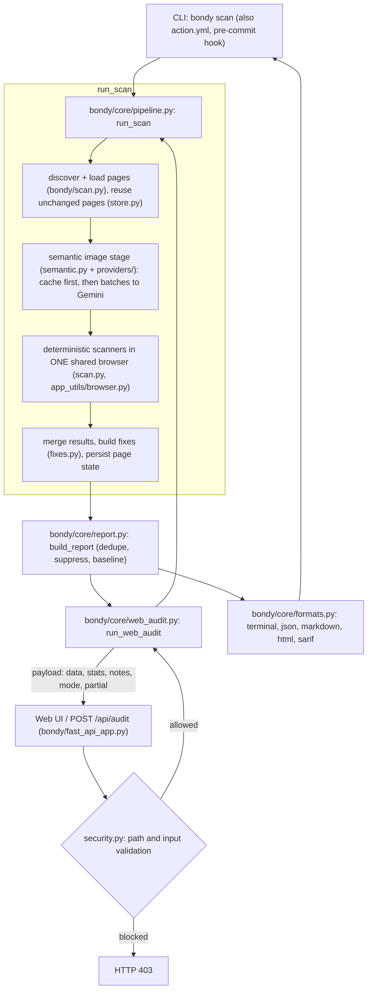

# Bondy — Architecture

This document describes how Bondy works **today** (v0.1.1) and marks what is legacy. For how to install and use it, see the [README](../README.md); for the history and pending work, see [improvement-plan.md](improvement-plan.md) and [CHANGELOG.md](../CHANGELOG.md).

---

## 1. Problem statement and WebAIM Million justification

Manual accessibility audits (WCAG 2.2 AA) are resource-intensive, and static code analyzers (Lighthouse, linters) only check for the presence of attributes (e.g., "does an alt attribute exist?") rather than their quality or semantic correctness.

Bondy targets the **6 main error categories representing 96% of actual accessibility issues** on the web, based on the **WebAIM Million 2026** report:

| WebAIM Million Category | % of Pages | Scanner (script under `bondy/resources/skills/`) | Type | WCAG Criterion |
| :--- | :--- | :--- | :--- | :--- |
| Low Contrast Text | 83.9% | `text-contrast-calculator` | Playwright (computed styles) | 1.4.3 |
| Missing Alt Text | 53.1% | semantic image stage (`bondy/core/semantic.py`) + HTML `img-alt` check | Gemini vision (optional) + deterministic | 1.1.1 |
| Missing Labels | 51.0% | `form-labels-validator` | Deterministic (DOM parsing) | 1.3.1 / 4.1.2 |
| Empty Links | 46.3% | `interactive-elements-validator` | Deterministic (DOM parsing) | 2.4.4 / 4.1.2 |
| Empty Buttons | 30.6% | `interactive-elements-validator` | Deterministic (DOM parsing) | 2.4.4 / 4.1.2 |
| Missing Language | 13.5% | `document-language-validator` | Deterministic (DOM parsing) | 3.1.1 |

Additional dynamic checks:

* `focus-order-validator` (Playwright) [2.4.3]
* `focus-trap-detector` (Playwright) [2.1.2]
* `axe-accessibility-scanner` (Playwright + axe-core 4.10.2, WCAG 2.0/2.1/2.2 A/AA, plus Chromium's accessibility tree)

The authoritative list of checks and their WCAG mapping is `bondy/core/checks.py` (also served at `GET /api/checks`).

---

## 2. Current architecture: a code-driven pipeline

Bondy does **not** use an LLM agent to decide what to do. Code drives the order of steps and makes the final decision; the model is only asked for what code cannot decide (what an image shows, whether it is decorative, a draft of the alt text). The `bondy/core/` package has no FastAPI, ADK or GCP dependency.



### Stages

1. **Discover and load.** `scan.discover` expands the given paths with `include`/`exclude`; `scan.load_page` reads each file once (that content is what is scanned and hashed). `--since` selects files changed against a git ref; `--changed-only`/`--resume` reuse results saved in the cache.
2. **Semantic image stage** (only with an API key and without `--no-llm`). `images.py` extracts `` elements; `alt_rules.py` triages in code (decorative signals, redundant prefixes, static alt checks); `redact.py` strips secret-looking values; `semantic.py` sends the rest in batches (`batch_size`, default 8) through an `LLMProvider` (`providers/gemini.py`, or `providers/fake.py` in tests) and validates the JSON answer against a schema. `budget.py` enforces the hard limits (`max_requests` default 50, `max_usd`, `max_pages`, `max_images`) and accounts usage; `estimate.py` powers `bondy estimate` / `--dry-run`. The cache is consulted first, so a bad key fails before any browser starts.
3. **Deterministic scanners.** `scan.run_scanners` loads the script of each skill folder (`bondy/resources/skills/*/scripts`) and runs axe-core, contrast, focus trap/order, `lang`, form labels, accessible names and the HTML `img-alt` check inside one shared browser (`app_utils/browser.py`). Every network request of the page is aborted except `data:`, `about:` and the scanned file. A per-page **watchdog** (`page_watchdog` in `app_utils/browser.py`, armed by `scan.scan_loaded`) enforces `--timeout` as a hard limit: `page.evaluate` has no timeout in Playwright, so when a page is still being scanned after `timeout` seconds (capped by what remains of `--scan-timeout`) a `threading.Timer` kills the process tree of the Playwright driver, the blocked call fails (`PageHungError`), the page is marked `skipped` and the scan continues in a fresh driver/browser (`BrowserSession.browser()` relaunches). Without a usable browser (or with `--static`) only the HTML-parsing checks run (static mode) and `notes` says which were skipped.
4. **Report.** `report.build_report` first merges duplicates (`dedupe.py`), then applies suppressions (`suppress.py`: `bondy-ignore` comments and `[[ignore]]`) and the baseline (`baseline.py`), so both act on the merged item; then `formats.py` renders the single internal `Report` into each output format.

### Deduplication

Several scanners can describe the same problem on the same element (for example axe `link-name`, the accessibility-tree check and the HTML check for an unnamed link). `bondy/core/dedupe.py` merges them conservatively and deterministically: same file, same problem family, and element descriptions that agree; never two items of the same rule; problems of a different nature never merge. The survivor keeps its own fingerprint, takes the worst severity and the union of WCAG criteria, and lists the others in `merged_from` with their original fingerprints.

Consequences:

* **Baselines:** an item is "known" if any of its own or merged fingerprints is in the baseline, so baselines made before the merge keep matching (`Item.all_fingerprints`).
* **Ignores:** a `bondy-ignore` comment or `[[ignore]]` matching the rule of any merged scanner applies to the merged item (`Item.all_rules`).
* **Cache:** the cache stores raw findings, never merged ones, so a fresh scan, `--changed-only` and `--resume` give the same result.
* **Output:** `merged_from` in JSON, `properties.mergedFrom` in SARIF, "Also reported by" in Markdown/HTML and a "Duplicates merged" count in the summary.

### Web UI path

`POST /api/audit` validates the input with `bondy/app_utils/security.py` (only raw HTML or a path inside `examples/`), runs `run_web_audit` in a worker thread (which builds `Settings`, writes pasted HTML to a temporary folder that is always removed, and calls `run_scan`) and adapts the `ScanReport` with `scan_to_payload`. `POST /api/apply-fix` writes one replacement to a file in `examples/` and is restricted to localhost or a valid `X-API-Key` (`BONDY_APPLY_TOKEN`; `BONDY_API_KEY` is a deprecated alias); `/api/audit` marks which fixes are safe to apply (`before_occurrences`).

`bondy/fast_api_app.py` builds a plain `FastAPI()` (UI, `/api/*`, `/feedback`, `/health`). The development-server routes of ADK (`/run`, `/run_sse`, `/run_live`, `/list-apps`, sessions, artifacts, `/docs`) are **opt-in**: only with `BONDY_ENABLE_AGENT_API=1` does `_build_app` import `google.adk` (lazily) and mount `get_fast_api_app`, wrapped in `_AgentApiGuard`, an ASGI middleware that requires `X-API-Key` (or a local client when no token is set) for everything outside `/`, `/static/`, `/api/*`, `/feedback` and `/health`. The app is no longer built on ADK. All server settings come from `config.load_server_settings()`; the project `.env` reaches `os.environ` only through the allowlist of `config.export_dotenv_to_environ`.

### Data contract of `/api/audit`

```yaml
# response (bondy/core/web_audit.py: scan_to_payload)
status: string
data:                   # list of fixes
  - finding_id: string
    wcag: string
    severity: enum[critical, warning, info]
    title: string
    before: string        # exact copy of the original HTML
    after: string
    explanation: string
    before_occurrences: int   # only for patches of local files
stats: {passes, violations, needs_review} | null   # from axe-core
source_type: string       # "raw_html" | "local_file"
file_path: string | null
notes: [string]
mode: string              # "llm" | "no-llm"
partial: bool
```

---

## 3. Security guardrails

1. **Input and path guardrail** (`bondy/app_utils/security.py`): for the web UI/API only raw HTML or paths strictly inside `examples/` are accepted; `..` and absolute paths are rejected. The CLI accepts any local path you pass it.
2. **SSRF guard** (`bondy/core/netguard.py`, `fetch_public_bytes`): the single download path for remote URLs (`core/images.py`, `app_utils/vision_tools.py` and the `fetch_image.py` skill script all delegate to it). It resolves the host once, requires every address to be public, connects to the already validated IP (original hostname kept for `Host`/SNI/certificate), re-validates each redirect (at most 3), rejects credentials in the URL and caps the bytes read. `security.validate_public_url` is only a pre-check and does not stop DNS rebinding by itself.
3. **Network confinement** (`bondy/app_utils/browser.py`): audited pages cannot reach the network.
4. **Secret redaction** (`bondy/core/redact.py`): applied before text is sent to the model, hashed into the cache or written to a report. Pattern based, not a guarantee.
5. **API key handling** (`bondy/config.py`): `GEMINI_API_KEY` / `GOOGLE_API_KEY` from the environment or the project `.env`, never from `bondy.toml`, never printed. Outside `config.py`, `doctor.py` and `app_utils/telemetry.py` nothing reads `os.environ` (enforced by `tests/unit/test_settings_only.py`).
6. **Write protection**: `/api/apply-fix` is localhost-only or `X-API-Key` (`BONDY_APPLY_TOKEN`), and refuses ambiguous replacements (409). `POST /api/audit` and `/feedback` are unauthenticated by design (local tool).
7. **Agent API off by default**: the ADK routes need `BONDY_ENABLE_AGENT_API=1` and are then guarded by the same token or local-client rule (see "Web UI path").
8. **Hung pages**: the per-page watchdog described in stage 3 bounds JS loops that no Playwright timeout can interrupt.
9. **Commit guardrails**: pre-commit runs `ruff` and `ruff format`.

---

## 4. Legacy and optional components

These remain in the repository but are **not** part of the CLI or of the web UI audit path:

| Component | What it is | Status |
| :--- | :--- | :--- |
| `bondy/agent.py` | ADK `LlmAgent` (`BondyAccessibilityAgent`) with a `SkillToolset` over `bondy/resources/skills`. | Legacy. Originally the whole product; superseded by the pipeline. It takes its model from `Settings.model` (`BONDY_MODEL` or `bondy.toml`, via `load_settings_lenient()`; no longer a literal). The CLI has no `--mode agent` (pending, see `improvement-plan.md`, D1/P4). `tests/integration/test_agent.py` still imports it. |
| `bondy/app_utils/vision_tools.py`, `render_page.py` | Gemini vision tools and page renderer used by the ADK agent. | Legacy (used by the agent). Models come from `Settings` on every call; remote images go through `core/netguard.py`. |
| `bondy/fast_api_app.py` ADK mount | `get_fast_api_app(...)` from ADK, mounted only with `BONDY_ENABLE_AGENT_API=1` and behind `_AgentApiGuard`. The app is otherwise a plain FastAPI app. | Opt-in. `pyproject.toml` still declares `server` as requiring `agent` (extras not yet split), but by code reading `google.adk` is imported only when the flag is set; running `server` without `agent` has not been verified. |
| Cloud Run deployment (`agents-cli`, Terraform, `gcp` extra, Cloud Logging/OTel) | Deployment of the web app to Google Cloud. | Optional, opt-in telemetry. |
| `.github/workflows/bondy-audit.yml` | Older CI workflow (`uv sync --all-extras`, ruff, unit tests). | Superseded by `ci.yml`; not verified to be intentionally kept. |

---

## 5. Module map

| Path | Responsibility |
| :--- | :--- |
| `bondy/cli.py`, `bondy/__main__.py` | Argument parsing, exit codes, progress/notice, `scan` / `estimate` / `doctor` / `baseline` / `cache`. |
| `bondy/config.py` | `bondy.toml` + environment + flags (flag > env > file > default); API key resolution (env, `.env`); `load_server_settings()` (apply token, `BONDY_ENABLE_AGENT_API`, origins, logging) and the `.env` allowlist export for the web server. |
| `bondy/doctor.py` | Offline environment checks; `--check-key` for one live request. |
| `bondy/scan.py` | File discovery, page loading, the deterministic scanner runners, static mode, per-page watchdog budget (`PAGE_TIMEOUT_SKIP`). |
| `bondy/app_utils/browser.py` | Single browser launcher, network-confined `open_page`, shared `browser_session` and `page_watchdog` (kills the driver tree of a hung page and relaunches). |
| `bondy/core/netguard.py` | `fetch_public_bytes`: the only remote download path (pinned validated IP, revalidated redirects, byte cap). |
| `bondy/core/pipeline.py` | `run_scan`: order of stages, reuse/resume, limits, exit codes. |
| `bondy/core/semantic.py`, `alt_rules.py`, `images.py`, `fixes.py` | Image stage: extraction, triage, batching, decision, fix templates. |
| `bondy/core/providers/` | `LLMProvider` interface, retry/fallback policy, Gemini client, fake provider for tests. |
| `bondy/core/budget.py`, `estimate.py` | Cost model, hard limits, usage, pre-flight estimate. |
| `bondy/core/store.py` | On-disk cache (`.bondy/cache`). |
| `bondy/core/report.py`, `dedupe.py`, `suppress.py`, `baseline.py`, `formats.py` | Internal report, duplicate merging, suppressions, baselines, renderers. |
| `bondy/core/web_audit.py` | Adapter between the pipeline and the web UI/API. |
| `bondy/fast_api_app.py`, `bondy/resources/web/` | FastAPI app and static UI. |
| `action.yml`, `.pre-commit-hooks.yaml`, `docs/ci-example.yml`, `.github/workflows/ci.yml` | CI integration and this repository's own CI. |

Verification status: the pipeline description above was checked against the code of `bondy/core/pipeline.py`, `bondy/core/dedupe.py`, `bondy/core/web_audit.py`, `bondy/core/netguard.py`, `bondy/config.py`, `bondy/fast_api_app.py` and `bondy/app_utils/browser.py`. The Docker image with Chromium was built and exercised locally on 2026-10-11 (`bondy doctor`, `bondy scan examples --no-llm`, `POST /api/audit`); the `docker` job of `ci.yml` has not run on GitHub. The watchdog was only exercised on Windows (the POSIX kill branch is untested), and the Cloud Run deployment path has not been verified.
